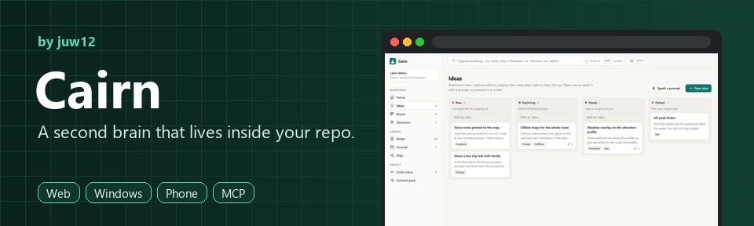
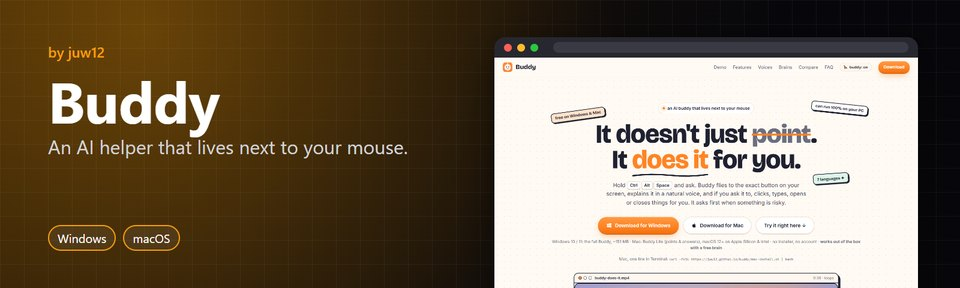
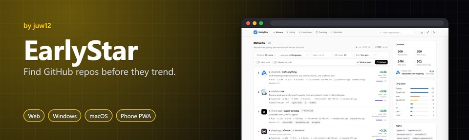
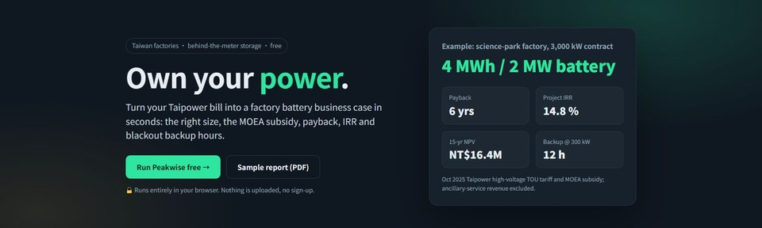
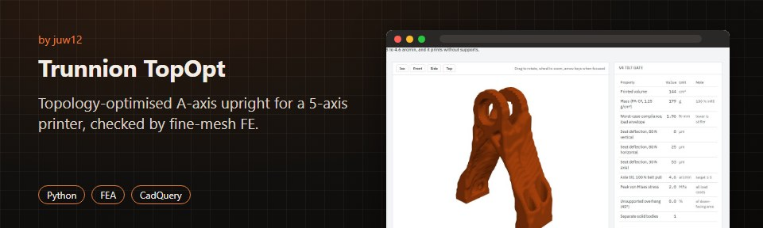
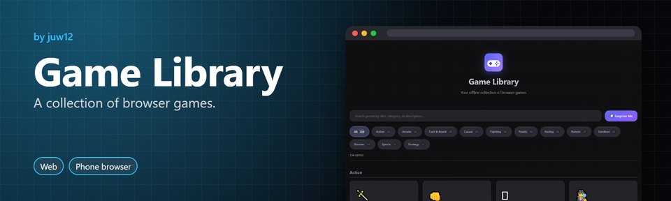
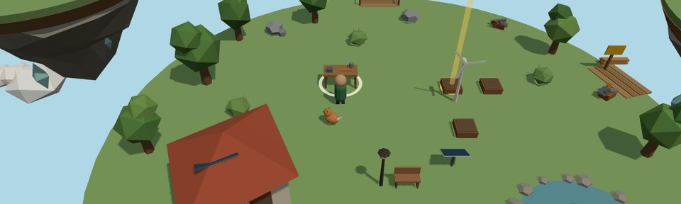
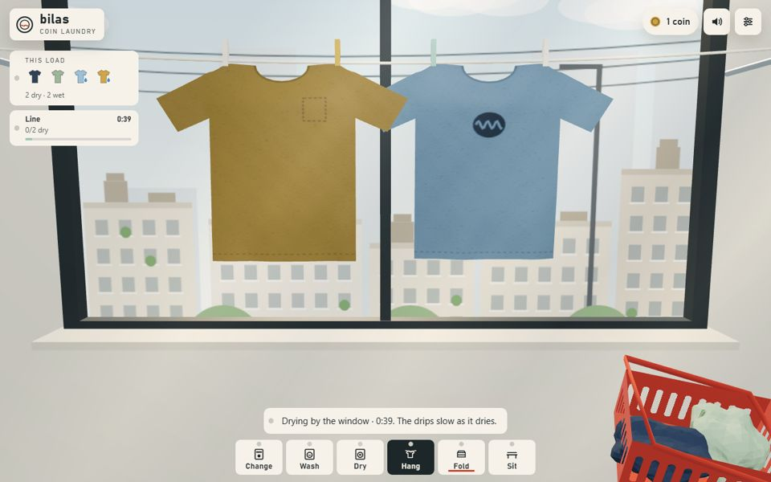
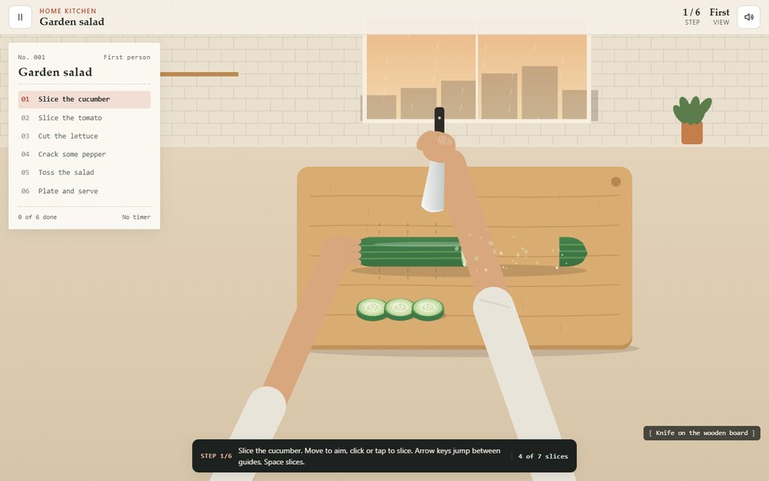

  

  <b>R&D mechanical engineer with an aerospace background: product reliability, DVT, NPI and root-cause analysis.</b> 
  On the side I build offline-first tools and AI experiments, and I'm learning Fortran for CFD work.

  <a href="https://juwenlie.pages.dev/"><b>Portfolio</b></a> ·
  <a href="https://linkedin.com/in/juwenlie"><b>LinkedIn</b></a> ·
  <a href="mailto:juwen12006@gmail.com"><b>Email</b></a> ·
  <a href="#featured">Featured</a> ·
  <a href="#engineering">Engineering</a> ·
  <a href="#building">Building</a> ·
  <a href="#tools">Tools</a> ·
  <a href="#games">Games</a> ·
  <a href="https://juw12.github.io/p/"><b>All landing pages</b></a>

  
  
  
  
  

<table>
  <tr>
    <td width="33%" valign="top">
      <b>Local-first</b> 
      No account, no server required. Most of what I ship keeps working offline.
    </td>
    <td width="33%" valign="top">
      <b>Real apps on every platform</b> 
      Desktop installers, Android and iPhone builds, and a live web demo you can try right now.
    </td>
    <td width="33%" valign="top">
      <b>Built like hardware</b> 
      Test suites run in CI on every push (badge above) and releases are versioned: verify before shipping, like a DVT build.
    </td>
  </tr>
</table>

## Featured

Ranked by how solid each project is: test suites, shipped releases and downloads, a working live demo and commit history.

<table>
  <tr>
    <td width="50%" valign="top">
       
      <b><a href="https://juw12.github.io/projects/twin/">Twin</a></b>: Invest and day-trade with a twin that replays 10,000 futures before you risk real money. 
      <a href="https://juw12.github.io/projects/twin/">Live demo</a> · <a href="https://github.com/juw12/projects/releases/tag/twin">Download</a> · <a href="https://juw12.github.io/p/twin/">Landing page</a> · 135 test files · <a href="https://github.com/juw12/projects/tree/main/apps/twin#readme">README</a>
    </td>
    <td width="50%" valign="top">
       
      <b><a href="https://juw12.github.io/cairn/?demo=1">Cairn</a></b>: A second brain that lives inside your repo: ideas, decisions and tasks as plain Markdown next to the code. Claude, Cursor or Copilot search and update it over MCP, a live dashboard shows your AI coding sessions, and your phone pairs by QR and stays in sync. Works with Obsidian; zero dependencies. 
      <a href="https://juw12.github.io/cairn/?demo=1">Live demo</a> · <a href="https://juw12.github.io/cairn/?u=juw12">My public brain</a> · <a href="https://juw12.github.io/p/cairn/">Landing page</a> · 26 test files · <a href="https://github.com/juw12/cairn#readme">README</a>
    </td>
  </tr>
  <tr>
    <td width="50%" valign="top">
       
      <b><a href="https://juw12.github.io/projects/glow/">Glow</a></b>: Six AI apps and a Telegram bot on one free account, in 4 languages. No API keys, and the apps keep working offline. 
      <a href="https://juw12.github.io/projects/glow/">Live demo</a> · <a href="https://github.com/juw12/projects/releases/tag/glow-windows">Download</a> · <a href="https://juw12.github.io/p/glow/">Landing page</a> · 28 test files · <a href="https://github.com/juw12/projects/tree/main/apps/glow#readme">README</a>
    </td>
    <td width="50%" valign="top">
       
      <b><a href="https://juw12.github.io/buddy/">Buddy</a></b>: Guides new factory engineers through PLM, SRM and ERP screens click by click, or clicks for them. Types what you say into any app, offline, in 15 language choices (4.9% English word errors vs 37% for Windows speech). Runs on local models and asks before risky actions. 
      <a href="https://github.com/juw12/buddy/releases/latest">Download</a> · <a href="https://juw12.github.io/buddy/">Landing page</a> · 11 test files · <a href="https://github.com/juw12/buddy#readme">README</a>
    </td>
  </tr>
  <tr>
    <td width="50%" valign="top">
       
      <b><a href="https://juw12.github.io/projects/mint/web.html">Mint</a></b>: Synced on every device, with expenses you log by texting Mint on WhatsApp. 
      <a href="https://juw12.github.io/projects/mint/web.html">Live demo</a> · <a href="https://github.com/juw12/projects/releases/tag/mint">Download</a> · <a href="https://juw12.github.io/p/mint/">Landing page</a> · 8 test files · <a href="https://github.com/juw12/projects/tree/main/apps/mint#readme">README</a>
    </td>
    <td width="50%" valign="top">
       
      <b><a href="https://juw12.github.io/earlystar/">EarlyStar</a></b>: Find GitHub repos before they trend, ranked by the stars they actually gained, with real activity next to the hype. 
      <a href="https://juw12.github.io/earlystar/">Live demo</a> · <a href="https://github.com/juw12/earlystar/releases/latest">Download</a> · <a href="https://juw12.github.io/p/earlystar/">Landing page</a> · 4 test files · <a href="https://github.com/juw12/earlystar#readme">README</a>
    </td>
  </tr>
</table>

## Engineering

Where the day job meets the side projects: motor test rigs, an NPI workbench, CAD automation, CFD studies, a factory battery check, a 3D model library and the small tools I use in R&amp;D.

<table>
  <tr>
    <td width="50%" valign="top">
       
      <b><a href="https://juw12.github.io/projects/airiz-motor/">Airiz Motor</a></b>: USB jog, remote control and camera by code, live device checks and a camera-based wobble test. 
      <a href="https://juw12.github.io/projects/airiz-motor/">Live demo</a> · <a href="https://github.com/juw12/projects/releases/tag/airiz-desktop-v1.11.25">Download</a> · <a href="https://juw12.github.io/p/airiz-motor/">Landing page</a> · 37 test files · <a href="https://github.com/juw12/projects/tree/main/apps/airiz-motor#readme">README</a>
    </td>
    <td width="50%" valign="top">
       
      <b><a href="https://juw12.github.io/projects/me-rd-toolkit/index.html">Datum Bench</a></b>: NPI task flow, review checklists, an issue log and 11 engineering calculators in one place. 
      <a href="https://juw12.github.io/projects/me-rd-toolkit/index.html">Live demo</a> · <a href="https://github.com/juw12/projects/releases/tag/me-rd-toolkit">Download</a> · <a href="https://juw12.github.io/p/datum-bench/">Landing page</a> · 11 test files · <a href="https://github.com/juw12/projects/tree/main/apps/me-rd-toolkit#readme">README</a>
    </td>
  </tr>
  <tr>
    <td width="50%" valign="top">
       
      <b><a href="https://github.com/juw12/projects/tree/main/apps/me-rd-toolkit/photo2cad">Datum CAD</a></b>: A PRD plus six reference photos becomes a validated STEP solid, with an STL preview. 
      <a href="https://juw12.github.io/p/datum-cad/">Landing page</a> · <a href="https://github.com/juw12/projects/tree/main/apps/me-rd-toolkit/photo2cad#readme">README</a>
    </td>
    <td width="50%" valign="top">
       
      <b><a href="https://github.com/juw12/cfd-wave-schemes">CFD Wave Schemes</a></b>: Upwind vs MacCormack for the 1-D wave equation: the original Fortran studies, a Python port tested against their output, and a side-by-side error comparison. 
      <a href="https://juw12.github.io/p/cfd-wave-schemes/">Landing page</a> · 4 tests in CI · <a href="https://github.com/juw12/cfd-wave-schemes#readme">README</a>
    </td>
  </tr>
  <tr>
    <td width="50%" valign="top">
       
      <b><a href="https://github.com/juw12/peakwise">Peakwise</a></b>: A neutral 60-second check of whether a battery pays back for a Taiwan factory, with the real Taipower tariff, the MOEA subsidy and a quote checker. 
      <a href="https://juw12.github.io/peakwise/">Live site</a> · <a href="https://juw12.github.io/p/peakwise/">Landing page</a> · <a href="https://github.com/juw12/peakwise#readme">README</a>
    </td>
    <td width="50%" valign="top">
       
      <b><a href="https://github.com/juw12/trunnion-topopt">Trunnion TopOpt</a></b>: A topology-optimised A-axis trunnion upright for a 5-axis 3D printer that stays stiff in every tilt direction and under belt pull, prints without supports, and is checked by fine-mesh FE. 
      <a href="https://juw12.github.io/trunnion-topopt/">Live site</a> · <a href="https://juw12.github.io/p/trunnion-topopt/">Landing page</a> · <a href="https://github.com/juw12/trunnion-topopt#readme">README</a>
    </td>
  </tr>
</table>

<b>4 more</b>: workplace tools I use in the R&amp;D day job and a 3D model library

- **[PLM AML Approval](https://github.com/juw12/projects/tree/main/apps/plm-aml-approval)** : Python and Playwright tool that walks a Windchill-based PLM part-approval (AML) workflow end to end, verifies every field and stops before Submit so a person makes the final check. [Landing page](https://juw12.github.io/p/plm-aml-approval/) · [README](https://github.com/juw12/projects/tree/main/apps/plm-aml-approval#readme)
- **[Outlook Archiver](https://github.com/juw12/projects/tree/main/apps/outlook-archiver)** : A small Windows daemon that keeps Outlook's Inbox and Sent Items empty by moving every message into an Archives PST, while logging each one and showing a desktop toast so nothing is missed. [Landing page](https://juw12.github.io/p/outlook-archiver/) · [README](https://github.com/juw12/projects/tree/main/apps/outlook-archiver#readme)
- **[tolstack](https://juw12.github.io/p/tolstack/)** : 1-D tolerance stack-up from a STEP assembly and 2D PDF drawings: ranked part chains, worst case, RSS, Cp/Cpk and Monte Carlo, written to an Excel report with live formulas, 2D evidence and a sign-off block. [Landing page](https://juw12.github.io/p/tolstack/) · CI on Ubuntu and Windows · [README](https://github.com/juw12/tolstack#readme)
- **[3D Models Library](https://github.com/juw12/projects/tree/main/outputs/3d-models)** : 41 landmark and character miniatures (world wonders, the tallest buildings, Snoopy and Mobile Suits) as STL for printing and STEP for CAD, mostly parametric CadQuery models for FDM, plus a 100 mm Kobo-chan figurine revised for Formlabs Form 3 resin printing. [Kobo-chan / Form 3](https://github.com/juw12/projects/tree/main/outputs/3d-models/kobochan) · [README](https://github.com/juw12/projects/tree/main/outputs/3d-models#readme)

## Building

<b>56 projects in progress</b>, grouped by type: life and health, social, learning, local business, creator tools, AI and developer tools, operating systems and languages, games

<!-- BUILDING:START -->
<!--caption-->Grouped by type; inside each group the most solid projects (tests, releases, a working demo) come first. Activity refreshes automatically every 2 hours.

#### Life, health and habits (10)

- **[Together](https://juw12.github.io/projects/together/)** : A private life plan for couples, from dating to retirement: a shared roadmap with both ages at every milestone, goals, savings and a monthly check-in. End-to-end encrypted, works offline. [Try the demo](https://juw12.github.io/projects/together/?demo=1). <!--live-->[Landing page](https://juw12.github.io/p/together/) · [README](https://github.com/juw12/projects/tree/main/apps/together#readme) · Updated [Nov 8](https://github.com/juw12/projects/commit/33e7d304c659d08195b2ff7acb91d736619a55de) · 1 commit this week<!--/live-->
- **[Haru](https://juw12.github.io/projects/haru/app/)** : A cozy photo diary and walking map: each day becomes a card with a tiny diorama lit by that day's weather. English, Japanese and Korean; runs in the browser, with [Android, Windows and Mac downloads](https://github.com/juw12/projects/releases/tag/haru-latest). Shares an optional [iPhone home-screen widget](https://juw12.github.io/pocketdex/widget/) with PocketDex and Cozy Island (free Scriptable app). <!--live-->[Landing page](https://juw12.github.io/p/haru/) · [README](https://github.com/juw12/projects/tree/main/apps/haru#readme) · Updated [Nov 13](https://github.com/juw12/projects/commit/f002c908e6a8a8f7b1d90147b5723eb23abd4689) · 2 commits this week<!--/live-->
- **[Nudge](https://github.com/juw12/nudge)** : Reads your own Instagram, WhatsApp, Telegram and iMessage exports to show who you have left on read, with a ready-to-send opener. Weekly digest, iOS widget, fully local. <!--live-->[Landing page](https://juw12.github.io/p/nudge/) · [README](https://github.com/juw12/nudge#readme) · Updated [Nov 7](https://github.com/juw12/nudge/commit/cf620a9315aabd1cdc133487768cafbe9e795281) · 1 commit this week<!--/live-->
- **[Jeda](https://juw12.github.io/jeda/)** : A quiet virtual space and living library for every faith in Indonesia. The no-setup Sejenak quick mode lights a candle in two taps and adds a wish lantern, a worry that dissolves, reflection cards (not fortunes), a gentle two-minute movement guide, prayer-bead cycles and opt-in ambient sound. Read teachings and rituals, track holy days and family memorials. Clergy-reviewed, works offline. <!--live-->[Landing page](https://juw12.github.io/p/jeda/) · [README](https://github.com/juw12/jeda#readme) · Updated [Nov 13](https://github.com/juw12/jeda/commit/29cd2ee5bc691d1ca133f7aab96488257afaf7e3) · 26 commits this week<!--/live-->
- **[Reda](https://juw12.github.io/reda/)** : A companion for chronic hives (biduran): a 30-second daily UAS7 check-in, a trigger finder that compares bad and good days, guided self-tests (scratch, ice cube, pressure, heat, exercise, sun) with real reference photos and timers, and a medicine plan that follows the international treatment ladder and prints a report for your doctor. Bahasa Indonesia and English, private on your phone, works offline. [Try the demo](https://juw12.github.io/reda/?demo=1). <!--live-->[Landing page](https://juw12.github.io/p/reda/) · [README](https://github.com/juw12/reda#readme) · Updated [Nov 10](https://github.com/juw12/reda/commit/342a6d71828edbc8c2de3bec57f86f78c56d5199) · 3 commits this week<!--/live-->
- **[Teman Sehat](https://juw12.github.io/projects/teman-sehat/)** : A GERD and acne lifestyle companion in English and Bahasa Indonesia: reminders, an after-meal timer, a trigger log and a skin routine. <!--live-->[Landing page](https://juw12.github.io/p/teman-sehat/) · [README](https://github.com/juw12/projects/tree/main/apps/teman-sehat#readme) · Updated [Nov 7](https://github.com/juw12/projects/commit/df9ac77fa8ddc1a759907e307841cacbc42721fb) · 1 commit this week<!--/live-->
- **[Vow](https://juw12.github.io/vow/)** : Keep the promises you make to yourself: free, private commitment contracts with a stake and a witness. Your witness's device holds the signing key, so a check-in only counts when they sign. Offline PWA, no account, no subscription. <!--live-->[Landing page](https://juw12.github.io/p/vow/) · [README](https://github.com/juw12/vow#readme) · Updated [Nov 9](https://github.com/juw12/vow/commit/4aa42e56c636183b6a690b77ad714fd6be487e01) · 14 commits this week<!--/live-->
- **[Lahap](https://juw12.github.io/lahap/?demo=1)**  : A food diary you can search. Snap a meal and it keeps just the food (background removed on your phone), estimates calories, protein, carbs and fat against the goal you set in a short quiz, and gives a tip for the next meal. The Lab turns what is in your fridge (typed, spoken in English or Bahasa, or a scanned list) into home recipes. “Have I eaten this?” search, favourites, a stamp book of places, a “Makan apa?” picker that chooses from your own diary, month and year recaps, Strava-style share cards and taste-matched buds. Smart and own collections, a food map, Share Studio collages and looping videos, 10 cut-out games, Ask Lahap questions and stories, bill scan, 6 colour themes, Windows 11 widgets and 14 languages. Offline PWA, free, no account. [Try the demo](https://juw12.github.io/lahap/?demo=1). <!--live-->[Landing page](https://juw12.github.io/p/lahap/) · [README](https://github.com/juw12/lahap#readme) · Updated [Nov 13](https://github.com/juw12/lahap/commit/985b79a33b02769fbcd0b5b929bf2affebe18cd6) · 74 commits this week<!--/live-->
- **[Ruang](https://juw12.github.io/ruang/)** : Turn a phone photo of your room into a 3D plan you can re-style in 7 looks, rearrange and renovate from country templates, then price in your local currency. A built-in architect flags walking space, door swing, sun and light, with a one-tap fix and cost for each. Windows app (installer or portable), signed Android APK, iPhone home-screen app or browser, in 7 languages; photos stay on the device. <!--live-->[Landing page](https://juw12.github.io/p/ruang/) · [README](https://github.com/juw12/ruang#readme) · Updated [Nov 10](https://github.com/juw12/ruang/commit/dbcfcd04ab1923344e344c575f8b71e8322a45e3) · 13 commits this week<!--/live-->
- **[Lelet](https://juw12.github.io/lelet/)** : Prove your internet is slower than the plan you pay for: timed speed tests against Cloudflare build a record, the app writes a ready-to-send complaint letter, then counts 7 working days and drafts a second letter if the provider stays silent. Bahasa Indonesia and English, no account, results stay on your phone. Not an official measurement and not legal advice. <!--live-->[Landing page](https://juw12.github.io/p/lelet/) · [README](https://github.com/juw12/lelet#readme) · Updated [Nov 14](https://github.com/juw12/lelet/commit/2da3b9607554bfcc1f5e5a07434588c2292e55b7) · 9 commits this week<!--/live-->

#### Social and community (7)

- **[Sync](https://juw12.github.io/projects/sync/)** : Listen to music together in real time from anywhere, with Spotify, Apple Music, YouTube and shared files in one room, plus voice chat that lowers the music. <!--live-->[Landing page](https://juw12.github.io/p/sync/) · [README](https://github.com/juw12/projects/tree/main/apps/sync#readme) · Updated [Nov 7](https://github.com/juw12/projects/commit/bc02ad3707a42089c7a01bee0f97b20981808fe4) · 1 commit this week<!--/live-->
- **[Peers](https://juw12.github.io/projects/peers/)** : Verified reviews across category modes (food, travel, market, AI tools, health, finance). Every category shares one interface, with a built-in Use it / Wait / Skip scorecard. <!--live-->[Landing page](https://juw12.github.io/p/peers/) · [README](https://github.com/juw12/projects/tree/main/apps/peers#readme) · Updated [Nov 10](https://github.com/juw12/projects/commit/095a0d8db0b0d81610b8db6c5a189f7fed770a1c) · 2 commits this week<!--/live-->
- **[Orbis](https://juw12.github.io/projects/orbis/)** : Communication, identity and protection in one app, plus Orbis Chat: real-time messaging with accounts, teams, email invites and push notifications on web, iPhone and Android. <!--live-->[Landing page](https://juw12.github.io/p/orbis/) · [README](https://github.com/juw12/projects/tree/main/apps/orbis#readme) · Updated [Nov 7](https://github.com/juw12/projects/commit/b31ee996add6868b7a06512588643a21cf1e7980) · 2 commits this week<!--/live-->
- **[Nongkrong](https://juw12.github.io/nongkrong/)** : A 3D warung kopi, kopitiam, angkringan or pub for your city: walk in as an avatar, sit at a table, and only the people at that table can read your messages or hear your voice. 23 countries, 107 regions, browser to browser, no account and no server. <!--live-->[Landing page](https://juw12.github.io/p/nongkrong/) · [README](https://github.com/juw12/nongkrong#readme) · Updated [Nov 9](https://github.com/juw12/nongkrong/commit/4b7dbfd4cfca64deb622363432cf4462a46f6c40) · 16 commits this week<!--/live-->
- **[Meetline](https://juw12.github.io/meetline/)** : Finds the fairest place for 2 to 8 people to meet, ranked by the longest road trip anyone makes, with a route drawn for each person (OpenStreetMap + OSRM, no server) <!--live-->[Landing page](https://juw12.github.io/p/meetline/) · [README](https://github.com/juw12/meetline#readme) · Updated [Nov 9](https://github.com/juw12/meetline/commit/1de16b443c8c114b3afc980dbba3074d76ae191b) · 54 commits this week<!--/live-->
- **[Rewind](https://juw12.github.io/projects/rewind/)** : A community archive for old TV series missing from today's streaming services: memories, quotes, a personal shelf and where each show can still be watched. <!--live-->[Landing page](https://juw12.github.io/p/rewind/) · [README](https://github.com/juw12/projects/tree/main/apps/rewind#readme) · Updated [Nov 7](https://github.com/juw12/projects/commit/df9ac77fa8ddc1a759907e307841cacbc42721fb) · 1 commit this week<!--/live-->
- **[shiphub](https://github.com/juw12/shiphub)** : Pinterest for app ideas: save ideas to boards, discuss and fork them, claim one with "I'm building this" and mark it shipped. GitHub sign-in, Python with SQLite or Postgres. <!--live-->[Landing page](https://juw12.github.io/p/shiphub/) · [README](https://github.com/juw12/shiphub#readme) · Updated [Nov 4](https://github.com/juw12/shiphub/commit/26d1897837564bb83f7bb132e8065d41ef220301) · quiet this week<!--/live-->

#### Learning and languages (3)

- **[Guang Yao Together 光耀同行](https://juw12.github.io/projects/guangyao/)** : An unofficial Traditional Chinese learning app with admin-published lessons, an AI study companion, spaced review and streaks. A PWA, an Android app and a free iPhone home-screen app. <!--live-->[Landing page](https://juw12.github.io/p/guang-yao-together/) · [README](https://github.com/juw12/projects/tree/main/apps/guangyao#readme) · Updated [Nov 7](https://github.com/juw12/projects/commit/262898d2bfe245ca01bf410deeecaf815d853b3a) · quiet this week<!--/live-->
- **[Lingua](https://juw12.github.io/projects/lingua/)** : Floats live translated captions over Microsoft Teams by reading the caption strip and translating it as people speak. <!--live-->[Landing page](https://juw12.github.io/p/lingua/) · [README](https://github.com/juw12/projects/tree/main/apps/lingua#readme) · Updated [Nov 7](https://github.com/juw12/projects/commit/e7f06ab2276cb061acbf2353b0fe732c65892282) · 1 commit this week<!--/live-->
- **[Nadaku](https://juw12.github.io/nadaku/)** : Offline HSK 1-6 Mandarin app for Indonesian speakers: personal FSRS reviews, a native-voice Tone Mirror, stroke order and a Hokkien loanword bridge. <!--live-->[Landing page](https://juw12.github.io/p/nadaku/) · [README](https://github.com/juw12/nadaku#readme) · Updated [Nov 13](https://github.com/juw12/nadaku/commit/d1d792cf18c137a60b4ac64519b61d42ad3cb1d7) · 12 commits this week<!--/live-->

#### Local business, marketplaces and travel (6)

- **[Fade](https://juw12.github.io/projects/fade/)** : A barber marketplace built on short videos: find a barber from a 15-second cut, then book, pay and tip them directly. Serverless on Nostr relays, 0% platform fee. <!--live-->[Landing page](https://juw12.github.io/p/fade/) · [README](https://github.com/juw12/projects/tree/main/apps/fade#readme) · Updated [Nov 14](https://github.com/juw12/projects/commit/54d36fbe326efdca3044d9baae8ca09495079c72) · 3 commits this week<!--/live-->
- **[Undanu](https://juw12.github.io/undanu/)** : Digital wedding invitations for Indonesia: personal WhatsApp links, RSVP and guest book, reminders and QR check-in on the day. Templates for every religion, Bahasa Indonesia and English, plain Python and SQLite. <!--live-->[Landing page](https://juw12.github.io/p/undanu/) · [README](https://github.com/juw12/undanu#readme) · Updated [Nov 7](https://github.com/juw12/undanu/commit/4f610f7bad77d13c729a7340a7d3d33236698efc) · 1 commit this week<!--/live-->
- **[Batam Uncle Says](https://juw12.github.io/batam-uncle-says/)** : Batam day trips for Singaporeans: a plan timed to your ferry, a fair-price check and phrase cards, in English and Chinese. Works offline. <!--live-->[Landing page](https://juw12.github.io/p/batam-uncle-says/) · [README](https://github.com/juw12/batam-uncle-says#readme) · Updated [Nov 13](https://github.com/juw12/batam-uncle-says/commit/e698d1ce23c0cf8c9ba38fb9050477a6347940a8) · 21 commits this week<!--/live-->
- **[Titian](https://github.com/juw12/projects/tree/main/respark)** : A broker-run B2B bridge for industrial manufacturers in Southeast Asia: 3D catalogs, RFQ baskets and a supplier portal, with every introduction screened. Built on Respark. <!--live-->[Landing page](https://juw12.github.io/p/respark/) · [README](https://github.com/juw12/projects/tree/main/respark#readme) · Updated [Nov 5](https://github.com/juw12/projects/commit/cd9b2b84d0f9f6cdaeda1f67a90ae26e229a3b1b) · quiet this week<!--/live-->
- **[KiniBuka](https://github.com/juw12/projects/tree/main/apps/kinibuka)** : Find small Indonesian UMKM stalls that are open right now: a live feed, a map and a walkable 3D market, follow alerts, and order-ahead with a one-tap WhatsApp handoff. Sellers are checked: WhatsApp-verified and admin-approved before they go live. <!--live-->[Landing page](https://juw12.github.io/p/kinibuka/) · [README](https://github.com/juw12/projects/tree/main/apps/kinibuka#readme) · Updated [Nov 13](https://github.com/juw12/projects/commit/4bee87e89c2c1ee070ce918585ae62e1dfddfa6e) · 5 commits this week<!--/live-->
- **[Tagalong](https://juw12.github.io/tagalong/?demo=1)** : A group trip planner: vote on ideas, build the days, split the bills to the cent and keep a private travel history. Changes sync live between phones (end-to-end encrypted over free public relays), with roles, plan lock, places and on-device receipt scan. No account, works offline, free Android APK and iPhone sideload build. <!--live-->[Landing page](https://juw12.github.io/p/tagalong/) · [README](https://github.com/juw12/tagalong#readme) · Updated [Nov 14](https://github.com/juw12/tagalong/commit/9c2f69ec2c0122f84446b09f18f8b16a747da8ad) · 15 commits this week<!--/live-->

#### Creator tools, media and research (13)

- **[Morrow](https://juw12.github.io/morrow/)** : A morning newspaper for markets, AI and chips, robotics, space and tech. Stories from several outlets merged into one, the Brief on top, and a stock desk with live prices and alerts. Light, Dark and Neo themes. <!--live-->[Landing page](https://juw12.github.io/p/morrow/) · [README](https://github.com/juw12/morrow#readme) · Updated [Nov 14](https://github.com/juw12/morrow/commit/a325957af099e31534993b451211019841554b79) · 90 commits this week<!--/live-->
- **[Atomize](https://juw12.github.io/atomize/)** : Paste one article and get LinkedIn posts, a numbered tweet thread, a newsletter and a short-video script. Runs in your browser: nothing is uploaded and there is no AI bill. <!--live-->[Landing page](https://juw12.github.io/p/atomize/) · [README](https://github.com/juw12/atomize#readme) · Updated [Nov 8](https://github.com/juw12/atomize/commit/9faf8e4996cf346ace3c0685384c0c52ec7d2555) · 1 commit this week<!--/live-->
- **[Hazel](https://juw12.github.io/projects/hazel/)** : One creator studio, three apps: Hazel Shorts for faceless explainer shorts, Hazel Sped for sped-up and mashup edits of your songs, and Hazel Long to create, cut and publish long-form video. <!--live-->[Landing page](https://juw12.github.io/p/hazel/) · [README](https://github.com/juw12/projects/tree/main/apps/hazel#readme) · Updated [Nov 10](https://github.com/juw12/projects/commit/095a0d8db0b0d81610b8db6c5a189f7fed770a1c) · 2 commits this week<!--/live-->
- **[House of Articles](https://juw12.github.io/projects/house-of-articles/)** : Athlete-moment sneaker news plus a live market feed, linking on-court moments to resale price moves. <!--live-->[Landing page](https://juw12.github.io/p/house-of-articles/) · [README](https://github.com/juw12/projects/tree/main/apps/house-of-articles#readme) · Updated [Nov 7](https://github.com/juw12/projects/commit/1ad0681e74725de5b558e7db82e35843d2c97d7b) · 1 commit this week<!--/live-->
- **[ReachPilot](https://juw12.github.io/reachpilot/)** : Turns my GitHub into a posting schedule: LinkedIn through the official API, plus Bluesky, Mastodon, Dev.to, and X, Threads and Substack free through Buffer. Uses only real README facts and live screenshots, never repeats itself, and learns from visitors per platform, stars and "Try it" clicks which projects to post next. <!--live-->[Landing page](https://juw12.github.io/p/reachpilot/) · [README](https://github.com/juw12/reachpilot#readme) · Updated [Nov 14](https://github.com/juw12/reachpilot/commit/7d07fce5f5821e7fd32c12b0877ebf275ffcfd19) · 43 commits this week<!--/live-->
- **[Millennium Digest](https://juw12.github.io/millennium-digest/results.html)** : An AI-assisted, engineer-run research loop on two Millennium Prize problems: a weekly paper digest plus pre-registered numerical tests on elliptic-curve murmurations (BSD) and zeta-zero spacings (RH). Latest: on 44,141 unseen curves the predicted 1/16 kink held, while one registered criterion missed by 0.005 and is reported as a failure. Observations, not proofs. <!--live-->[Landing page](https://juw12.github.io/p/millennium-digest/) · [README](https://github.com/juw12/millennium-digest#readme) · Updated [Nov 13](https://github.com/juw12/millennium-digest/commit/27b7d9642a38221577d0505dea53173742fa813b) · 21 commits this week<!--/live-->
- **[LaunchKit](https://github.com/juw12/launchkit)** : Promote an app before it ships: a referral waitlist, reward emails, an AI build-in-public post writer, tracked links per signup and a launch-week checklist. Zero-dependency Python and SQLite. <!--live-->[Landing page](https://juw12.github.io/p/launchkit/) · [README](https://github.com/juw12/launchkit#readme) · Updated [Nov 4](https://github.com/juw12/launchkit/commit/e8a5431d488fd94d45e56df6dea33f38f890c5d4) · quiet this week<!--/live-->
- **[Signals](https://github.com/juw12/signals)** : A $0-capital crypto signal bot: RSI, MACD, ATR and EMA confluence alerts on 4h candles, with paper trading, a backtester and a risk-capped executor. <!--live-->[Landing page](https://juw12.github.io/p/signals/) · [README](https://github.com/juw12/signals#readme) · Updated [Nov 13](https://github.com/juw12/signals/commit/1defeb379c4bb8059fc00e776f22fb767bf12389) · 1 commit this week<!--/live-->
- **[Jepret](https://juw12.github.io/jepret/)**  : Camera photos in (sent to your phone or off the SD card), stock upload files out. Removes blurry shots and burst duplicates, flags photos under 4 MP, groups scenes, writes titles and up to 49 keywords, and exports the Adobe Stock and Shutterstock CSV files. Works offline as a web app, an installable phone app or a Windows exe; photos never leave your device. <!--live-->[Landing page](https://juw12.github.io/p/jepret/) · [README](https://github.com/juw12/jepret#readme) · Updated [Nov 11](https://github.com/juw12/jepret/commit/8f97dd7ac8393b4ce5c84c0b289df04fbc0d902a) · 16 commits this week<!--/live-->
- **[Bits & Tickers](https://juw12.github.io/bits-and-tickers/)**  : What got built, and what it's worth. A podcast on tech, AI and markets with two hosts, Alex and Maya, in two series: First Tick (the day's news in about half an hour, every morning) and Day One (how one well-known company started, Sundays). Every story is linked in the show notes, with timed transcripts, short promo clips, an original theme, an RSS feed and a newsletter. <!--live-->[Landing page](https://juw12.github.io/p/bits-and-tickers/) · [README](https://github.com/juw12/bits-and-tickers#readme) · Updated [Nov 14](https://github.com/juw12/bits-and-tickers/commit/500070e589f84e52b09d45dc2896747538c26a49) · 7 commits this week<!--/live-->
- **[Social Saver](https://juw12.github.io/p/social-saver/)**  : One Windows app to save your own and followed accounts' posts, reels, videos, stories and highlights from Instagram, Threads, X and TikTok. Pick the types, sign in once for private accounts you follow, and get one zip per account with a folder per type and no duplicates. Runs on your PC; nothing is uploaded. <!--live-->[Landing page](https://juw12.github.io/p/social-saver/) · [README](https://github.com/juw12/social-saver#readme) · Updated [Nov 14](https://github.com/juw12/social-saver/commit/661b61bddd27f18ac5031fa66bdeaa0a8e5de4d4) · 13 commits this week<!--/live-->
- **[Telisik](https://juw12.github.io/telisik/)**  : A search page for questions where the source matters. One query goes from your browser to up to 23 public libraries (Wikipedia, Stack Exchange, Hacker News, GitHub, OpenAlex, Europe PMC, Internet Archive, Open Library and fifteen more); results are ranked with a formula printed on the page and quoted word for word. No server, no account, no generated text. <!--live-->[Landing page](https://juw12.github.io/p/telisik/) · [README](https://github.com/juw12/telisik#readme) · Updated [Nov 14](https://github.com/juw12/telisik/commit/a8db7c730596cf76943dae1e20b9bbc2a0a7aa68) · 3 commits this week<!--/live-->
- **[Vera Checks](https://juw12.github.io/not-real-vera/)**  : A short-video channel kit about scam and deepfake defence with one on-camera presenter. Five scripted episodes traced to FBI IC3 alerts, a renderer that turns a script into a vertical video with voice and captions, and a scheduler that sends approved episodes to YouTube, Instagram and TikTok through Buffer. Nothing has been posted yet: every episode waits for a human to watch and approve it. <!--live-->[Landing page](https://juw12.github.io/p/not-real-vera/) · [README](https://github.com/juw12/not-real-vera#readme) · Updated [Nov 14](https://github.com/juw12/not-real-vera/commit/49e757fe2ff37a400344e9fa6d74044f5e751d22) · 2 commits this week<!--/live-->

#### AI and developer tools (12)

- **[Sweep](https://github.com/juw12/projects/tree/main/apps/sweep)** : The `/sweep` pipeline: validate an idea, then sync the repo to GitHub and mirror a note to Obsidian. PowerShell helper plus an OpenCode slash command. <!--live-->[Landing page](https://juw12.github.io/p/sweep/) · [README](https://github.com/juw12/projects/tree/main/apps/sweep#readme) · Updated [Nov 10](https://github.com/juw12/projects/commit/65d53656c7c464db374df724919d659d12a0d62b) · 1 commit this week<!--/live-->
- **[Vitals](https://juw12.github.io/projects/vitals/index.html)** : Cleans storage you can undo, forecasts battery wear and finds what drains your device. [Download](https://github.com/juw12/projects/releases/tag/vitals) · 6 test files. <!--live-->[Landing page](https://juw12.github.io/p/vitals/) · [README](https://github.com/juw12/projects/tree/main/apps/vitals#readme) · Updated [Nov 7](https://github.com/juw12/projects/commit/df9ac77fa8ddc1a759907e307841cacbc42721fb) · 1 commit this week<!--/live-->
- **[Push Lab](https://github.com/juw12/projects/tree/main/apps/pushlab)** : Two tools for mobile QA: Beacon is a self-hosted push server, and Tether puts your Android phone in the browser with scripted QA flows. <!--live-->[Landing page](https://juw12.github.io/p/pushlab/) · [README](https://github.com/juw12/projects/tree/main/apps/pushlab#readme) · Updated [Nov 5](https://github.com/juw12/projects/commit/c531130ce58ce78c4a203f38b7e878a67a5d2e3e) · quiet this week<!--/live-->
- **[Retrace](https://juw12.github.io/retrace/)** : Finds the AI, prompt, model and settings behind an image, a text, a website or a chatbot API. Website scans end with a dated AI-transparency evidence report you can print as a PDF. Local app, Python standard library only. <!--live-->[Landing page](https://juw12.github.io/p/retrace/) · [README](https://github.com/juw12/retrace#readme) · Updated [Nov 9](https://github.com/juw12/retrace/commit/db2e9ac7c30763448489a08335db9967c69e570b) · 2 commits this week<!--/live-->
- **[scentvec](https://juw12.github.io/scentvec/)**  : An embedding model and search engine for finished perfumes. Turns a note pyramid (top, heart and base notes) into one 128-dimensional vector, then finds what is similar, searches in plain words ("smoky vanilla tobacco, not too sweet, no patchouli") or blends two perfumes, across 44,658 perfumes from 1,888 brands. Command line, local web app and JSON API; the [browser demo](https://juw12.github.io/scentvec/) runs the trained network with no server. <!--live-->[Landing page](https://juw12.github.io/p/scentvec/) · [README](https://github.com/juw12/scentvec#readme) · Updated [Nov 13](https://github.com/juw12/scentvec/commit/13aee7909c35bc534c9a5f410b2638a8820a8ff4) · 4 commits this week<!--/live-->
- **[gate](https://juw12.github.io/gate/)** : A merge gate for code written by AI coding agents: many agent sessions go in, a few tested, risk-tiered commits come out. Batches and bisects tests, reverts a red main automatically, holds risky changes for a named approver, blocks secrets, and `gate audit` reports every agent merge, refusal and bypass for an auditor. One Python file, standard library only; 61 tests on Linux, macOS and Windows. Released as [v0.5.0](https://github.com/juw12/gate/releases/tag/v0.5.0). <!--live-->[Landing page](https://juw12.github.io/p/gate/) · [README](https://github.com/juw12/gate#readme) · Updated [Nov 7](https://github.com/juw12/gate/commit/e6e4ab1fd6e7cd53fb40dbd7c496cb6d864ef7b0) · 4 commits this week<!--/live-->
- **[Steward](https://juw12.github.io/steward/)** : An OpenAI-compatible proxy that keeps a customer-facing chatbot on task: redirects drift, blocks prompt injection and logs cost per feature. Includes ScopeGuard's allow, steer, redirect or block rules. Python and TypeScript SDKs and a [live playground](https://juw12.github.io/steward/). <!--live-->[Landing page](https://juw12.github.io/p/steward/) · [README](https://github.com/juw12/steward#readme) · Updated [Nov 7](https://github.com/juw12/steward/commit/b152792f54395b99f5a22f5674c2ef8c49fe3860) · 2 commits this week<!--/live-->
- **[Hexbane](https://juw12.github.io/hexbane/)** : Breaks the hex before your AI agent falls for it. Scans agent skills, MCP servers and tool lists for prompt injection, hidden or disguised text (base64, homoglyphs, zero-width, leetspeak), secret theft and risky commands (browser, CLI, GitHub Action with SARIF), then gates tool calls and chat at run time. Held-out set: 11/11 attacks flagged, 0/5 false alarms; disguised attacks flagged 65/65. <!--live-->[Landing page](https://juw12.github.io/p/hexbane/) · [README](https://github.com/juw12/hexbane#readme) · Updated [Nov 13](https://github.com/juw12/hexbane/commit/1d79a619f898a9cbae224d1ff00478507c6c476d) · 19 commits this week<!--/live-->
- **[The State of MCP Servers](https://juw12.github.io/state-of-mcp-servers/)**  : A Gardu security report (the scan engine behind Hexbane) on the top public MCP servers and skills: catalogs the ecosystem (about 359,500 repos match `mcp`), scans the 7 most-starred cloneable servers plus Anthropic's skills repo, and explains why every one lands at REVIEW with 0 real high-severity findings. Open data, reproducible. <!--live-->[Landing page](https://juw12.github.io/p/state-of-mcp-servers/) · [README](https://github.com/juw12/state-of-mcp-servers#readme) · Updated [Nov 13](https://github.com/juw12/state-of-mcp-servers/commit/938b98373d150dd270af7e59fa712bdd034444ea) · 4 commits this week<!--/live-->
- **[Sortie](https://juw12.github.io/projects/sortie/)** : A playful, fully undoable file organizer: files fly into their folders, deletes go into a recoverable bag, and an AI assistant proposes a plan you run or cancel. <!--live-->[Landing page](https://juw12.github.io/p/sortie/) · [README](https://github.com/juw12/projects/tree/main/apps/sortie#readme) · Updated [Nov 7](https://github.com/juw12/projects/commit/df9ac77fa8ddc1a759907e307841cacbc42721fb) · 1 commit this week<!--/live-->
- **[E-coder](https://github.com/juw12/projects/tree/main/agents-lab/E-coder)** : A stdlib-only coding agent that plans, edits files and runs commands behind a deny-list and fail-closed confirmation. Local Ollama by default; 67 hermetic tests, no third-party dependencies. <!--live-->[Landing page](https://juw12.github.io/p/e-coder/) · [README](https://github.com/juw12/projects/tree/main/agents-lab/E-coder#readme) · Updated [Nov 3](https://github.com/juw12/projects/commit/2969b3bfed1876259ed09b5f5a83c6718e867549) · quiet this week<!--/live-->
- **[SkillMouse](https://github.com/juw12/skillmouse)** : Run your Claude Code, Codex and OpenCode skills on any selected text, straight from the mouse, with a local Ollama model or any OpenAI-compatible endpoint. Raycast-style launcher; Windows, single-file Python. <!--live-->[Landing page](https://juw12.github.io/p/skillmouse/) · [README](https://github.com/juw12/skillmouse#readme) · Updated [Nov 7](https://github.com/juw12/skillmouse/commit/50d9889bff2716cc633e2f8bf8d85fdbb5fb6a6c) · quiet this week<!--/live-->

#### Operating systems and programming languages (2)

- **[Inti](https://juw12.github.io/inti/)**  : A small operating system written from scratch that you can break on purpose (working name: Kokoh OS). Its own boot sector, a capability microkernel in 2,673 lines of Rust, and drivers that run as ordinary programs: crash or hang one in the browser demo and it is restarted without a reboot. A hostile test program's 47 attempts are all denied in QEMU. A research toy: emulator only, one processor, no network, nothing saved between runs, not formally verified. <!--live-->[Landing page](https://juw12.github.io/p/inti/) · [README](https://github.com/juw12/inti#readme) · Updated [Nov 13](https://github.com/juw12/inti/commit/b112a23a1963a7617be7fdeef10a8cc0cd1b171b) · 49 commits this week<!--/live-->
- **[Kilat](https://juw12.github.io/kilat/)**  : A small programming language for engineering calculations and safe scripts, written from scratch in Rust with no dependencies: units and types are checked before a program runs, so `2 m + 3 kg` is refused instead of printing a number, and scripts run in a sandbox with step and memory limits. It runs in the browser, inside Python and as a Cairn plugin. Version 0.2.1 measured 3.1x CPython speed across 10 benchmarks (2.8x with start-up taken out, only 1.1x on strings and map counting); it does not beat Python at everything. <!--live-->[Landing page](https://juw12.github.io/p/kilat/) · [README](https://github.com/juw12/kilat#readme) · Updated [Nov 13](https://github.com/juw12/kilat/commit/94690f40b2d15d2b8e56f1d5075bf9eca15999f7) · 16 commits this week<!--/live-->

#### Games and desktop companions (4)

- **[Pips](https://juw12.github.io/projects/pips/web.html)** : Desktop pet and Pomodoro widget for Windows: 51 animated animals, skill battles, minigames, live weather and 4 languages. <!--live-->[Landing page](https://juw12.github.io/p/pips/) · [README](https://github.com/juw12/projects/tree/main/apps/pips#readme) · Updated [Nov 10](https://github.com/juw12/projects/commit/65d53656c7c464db374df724919d659d12a0d62b) · 2 commits this week<!--/live-->
- **[Hoki](https://juw12.github.io/hoki/)** : A waving Chinese lucky cat (招财猫). Windows app with a live 3D desktop cat that watches your mouse, an offline Android app with a home-screen widget, and a PWA. Tap it for a luck boost. <!--live-->[Landing page](https://juw12.github.io/p/hoki/) · [README](https://github.com/juw12/hoki#readme) · Updated [Nov 9](https://github.com/juw12/hoki/commit/6d84a0af801b130200616ead2b544d280f23c718) · 41 commits this week<!--/live-->
- **[Who Threw?](https://juw12.github.io/mlbb-blame/)**  : Settles who threw (or carried) a Mobile Legends match: paste or screenshot the end-screen stats and each player gets a role-aware 0-10 score, blame or credit shares that add up to 100%, and the maths behind it on every card. The verdict says why this player and not the next one, and whether the call holds up if a few numbers change, then goes to the squad chat as a detailed or compact result image in one tap. Works offline and keeps a squad history. Role baselines are the app's own estimates, not official game data. [Landing page](https://juw12.github.io/p/mlbb-blame/) · [README](https://github.com/juw12/mlbb-blame#readme) <!--live-->[Landing page](https://juw12.github.io/p/mlbb-blame/) · [README](https://github.com/juw12/mlbb-blame#readme) · Updated [Nov 11](https://github.com/juw12/mlbb-blame/commit/5a9ba894819d3e7b1e76d1162af7257af20839b7) · 9 commits this week<!--/live-->
- **[PocketDex](https://juw12.github.io/pocketdex/)**  : A calm pixel-sprite Pokédex you use every day: all 1025 Pokémon with stats, matchups and evolutions, a daily encounter, habits that level up your partner, a focus timer where you catch what you work for, a Field Dex camera that turns real things into Game Boy sprites, and a quiet 3D meadow. Offline, no account. Shares an optional [iPhone home-screen widget](https://juw12.github.io/pocketdex/widget/) with Haru and Cozy Island (free Scriptable app). Unofficial fan project. <!--live-->[Landing page](https://juw12.github.io/p/pocketdex/) · [README](https://github.com/juw12/pocketdex#readme) · Updated [Nov 13](https://github.com/juw12/pocketdex/commit/0ec022eb08d075226a9dcf52b751b7b42e5e090b) · 15 commits this week<!--/live-->
<!-- BUILDING:END -->

## Tools and agent skills

<b>2 standalone tools</b>, each in its own repo: precedent (agent autopilot) and CPU Eco Toggle (Windows tray switch)

- **[precedent](https://juw12.github.io/p/precedent/)**  : Stops false "I can't"s and unchecked "done"s in AI coding agents. Before an agent gives up, it finds a past success in your own agents' history and sends the give-up back with it; before it claims done, it asks for a real check. Hooks in Claude Code, Codex CLI, Gemini CLI, OpenCode and GitHub Copilot CLI; MCP tools for Cursor, Windsurf, VS Code and Claude Desktop. 106 tests; the runtime needs only the Python standard library. [Landing page](https://juw12.github.io/p/precedent/) · [README](https://github.com/juw12/precedent#readme)
- **[CPU Eco Toggle](https://github.com/juw12/cpu-eco-toggle)** : A one-click Windows tray switch for when agents, builds and local LLMs pin the CPU at 100%: it moves windowless background jobs onto fewer cores at lower priority without stopping anything, and one more click restores them.

<b>22 tools</b> in <a href="https://github.com/juw12/tools">juw12/tools</a>: small, local and private, Python standard library only (<a href="https://juw12.github.io/p/tools/">landing page</a>)

No accounts and every tool ships with a self-test. See the <a href="https://juw12.github.io/p/tools/">landing page</a> or <a href="https://github.com/juw12/tools#readme">README</a>; scaffold a new one with <code>python3 toolbox.py new &lt;name&gt;</code>.

#### Money (5)

- **[Subscription Leak Finder](https://github.com/juw12/tools/blob/main/tools/subscription_leaks.py)**: Reads your bank CSV and finds hidden recurring charges, quiet price rises, trials that turned paid and overlapping services. Demo: `python3 toolbox.py demo subscription_leaks`
- **[Bank Fee Detector](https://github.com/juw12/tools/blob/main/tools/fee_detector.py)**: Finds overdraft, FX, ATM and maintenance fees, flags stacked overdrafts and drafts a refund request. Demo: `python3 toolbox.py demo fee_detector`
- **[Contract Red-Flag Scanner](https://github.com/juw12/tools/blob/main/tools/contract_redflags.py)**: Scans a contract for auto-renewals, cancellation traps, data sharing and forced arbitration. Demo: `python3 toolbox.py demo contract_redflags`
- **[Shrinkflation Detector](https://github.com/juw12/tools/blob/main/tools/shrinkflation.py)**: Catches shrinking packs that hide a real price rise by comparing price per unit over time. Demo: `python3 toolbox.py demo shrinkflation`
- **[Warranty Tracker](https://github.com/juw12/tools/blob/main/tools/warranty_tracker.py)**: Tracks warranties before they expire unnoticed and flags purchases with missing receipts. Demo: `python3 toolbox.py demo warranty_tracker`

#### Safety (6)

- **[Scam Message Checker](https://github.com/juw12/tools/blob/main/tools/scam_check.py)**: Checks a message for phishing, fake parcel and 'Hi Mum' scams, including look-alike links. Demo: `python3 toolbox.py demo scam_check`
- **[Fake Shop Checker](https://github.com/juw12/tools/blob/main/tools/fake_shop_check.py)**: Spots fake online shops: irreversible payment methods, 80%-off 'closing down' scripts and an optional domain-age lookup. Demo: `python3 toolbox.py demo fake_shop_check`
- **[Rental Scam Checker](https://github.com/juw12/tools/blob/main/tools/rental_scam_check.py)**: Flags fake rental listings: pay before viewing, absent landlord, rent far below market. Demo: `python3 toolbox.py demo rental_scam_check`
- **[Voice-Clone Safe-Word Kit](https://github.com/juw12/tools/blob/main/tools/voice_clone_safeword.py)**: Sets up a family safe phrase and call-back rule against AI voice-clone 'emergency' calls. Demo: `python3 toolbox.py demo voice_clone_safeword`
- **[Fake Job Interview Lure Checker](https://github.com/juw12/tools/blob/main/tools/job_lure_check.py)**: Detects fake-recruiter lures: 'run our repo' tests, ClickFix terminal commands, fake meeting links and moves to Telegram. Demo: `python3 toolbox.py demo job_lure_check`
- **[Interview Code-Test Triage](https://github.com/juw12/tools/blob/main/tools/code_test_triage.py)**: Scans a take-home coding test without running it, for install hooks, VS Code auto-run tasks, credential theft and hidden payloads. Demo: `python3 toolbox.py demo code_test_triage`

#### Privacy (1)

- **[GDPR / CCPA Deletion Request Generator](https://github.com/juw12/tools/blob/main/tools/privacy_requests.py)**: Writes GDPR / CCPA deletion letters to data brokers and tracks their legal deadlines. Demo: `python3 toolbox.py demo privacy_requests`

#### Climate (3)

- **[Heat Risk Planner](https://github.com/juw12/tools/blob/main/tools/heat_risk.py)**: Uses the NWS heat index and a live forecast to plan safe hours for outdoor work. Demo: `python3 toolbox.py demo heat_risk`
- **[Hidden Water Leak Detector](https://github.com/juw12/tools/blob/main/tools/water_leak.py)**: Finds hidden leaks from continuous night-time meter flow and estimates the yearly waste. Demo: `python3 toolbox.py demo water_leak`
- **[Energy Upgrade Payback](https://github.com/juw12/tools/blob/main/tools/energy_payback.py)**: Gives an honest payback, NPV and IRR for solar, heat pumps and insulation. Demo: `python3 toolbox.py demo energy_payback`

#### Care (2)

- **[Caregiver Medication Planner](https://github.com/juw12/tools/blob/main/tools/med_refills.py)**: Helps carers plan medication: run-out dates, a reorder list and a daily dose schedule. Demo: `python3 toolbox.py demo med_refills`
- **[Unclaimed Benefits Screener](https://github.com/juw12/tools/blob/main/tools/benefit_finder.py)**: Screens US and UK benefits worth checking and points to the official calculators. Demo: `python3 toolbox.py demo benefit_finder`

#### Future-proofing (5)

- **[Digital Legacy Planner](https://github.com/juw12/tools/blob/main/tools/legacy_planner.py)**: Finds digital inheritance gaps (crypto, 2FA, heirs) and writes instructions for your executor. Demo: `python3 toolbox.py demo legacy_planner`
- **[Account Recovery Audit](https://github.com/juw12/tools/blob/main/tools/account_recovery_audit.py)**: Maps how your accounts recover each other: SIM-swap blast radius, email chains and missing backup codes. Demo: `python3 toolbox.py demo account_recovery_audit`
- **[3-2-1 Backup Auditor](https://github.com/juw12/tools/blob/main/tools/backup_check.py)**: Audits your backups against the 3-2-1 rule and catches 'cloud sync is not a backup' and untested restores. Demo: `python3 toolbox.py demo backup_check`
- **[Bit-Rot Guard](https://github.com/juw12/tools/blob/main/tools/bitrot_guard.py)**: Detects silent file corruption using SHA-256 fingerprints. Demo: `python3 toolbox.py demo bitrot_guard`
- **[File Format Rescue](https://github.com/juw12/tools/blob/main/tools/file_rescue.py)**: Finds files stuck in dying formats and gives the exact command to convert each one. Demo: `python3 toolbox.py demo file_rescue`

<b>14 agent skills</b> in <a href="https://github.com/juw12/skills">juw12/skills</a>: plain <code>SKILL.md</code> files for Claude Code, OpenCode, Codex and <a href="https://github.com/juw12/skillmouse">SkillMouse</a> (<a href="https://juw12.github.io/p/skills/">landing page</a>)

Agents that verify instead of claiming: they run the checks, report honestly and stop when they should. See the <a href="https://github.com/juw12/skills#readme">README</a>; install with <code>git clone https://github.com/juw12/skills</code>.

#### Workflow: verify instead of claim (9)

- **[agent-lessons](https://juw12.github.io/p/agent-lessons/)** : 675 hard-won lessons from shipping 60+ projects with AI coding agents, sorted into 12 chapters with the 15 rules that matter most on top. Drop it into AGENTS.md or CLAUDE.md, or build your own with the bundled redact-and-leak-check script.
- **[hone](https://github.com/juw12/skills/blob/main/skills/hone/SKILL.md)**: `/hone`: improve-until-done with full autonomy. Frozen rubric, separate judge, objective checks over the judge, keep-best and blind pairwise checks; works a run queue until it is empty and ends with `Stopped: <reason>`. Successor of refine-loop.
- **[refine-loop](https://github.com/juw12/skills/blob/main/skills/refine-loop/SKILL.md)**: The original loop, for agents that should ask before acting. Improve-until-done without babysitting: frozen rubric, baseline score, separate judge, keep-best, blind A/B check against score inflation and hard stop rules. Ships an objective self-checker.
- **[ambitious-founder](https://github.com/juw12/skills/blob/main/skills/ambitious-founder/SKILL.md)**: `/be-ambitious` + `/founder`: raises any task (goal beyond the goal, expert depth, outside judge) and pressure-tests a business idea with a buyer panel, Van Westendorp pricing and unit economics, ending in a script-computed verdict.
- **[harness](https://github.com/juw12/skills/blob/main/skills/harness/SKILL.md)**: Finds and actually runs a project's build, test and lint commands, and reports pass/fail truthfully.
- **[heartbeat](https://github.com/juw12/skills/blob/main/skills/heartbeat/SKILL.md)**: A short, honest status of running jobs and services (servers, watchdogs, long tasks) that flags stalls.
- **[delegator](https://github.com/juw12/skills/blob/main/skills/delegator/SKILL.md)**: Breaks a goal into small tasks, routes each to the best agent or skill, then combines the results.
- **[soul](https://github.com/juw12/skills/blob/main/skills/soul/SKILL.md)**: Reviews drafts, docs and UI copy against a project's voice and principles, with minimal fixes.
- **[memory-management](https://github.com/juw12/skills/blob/main/skills/memory-management/SKILL.md)**: Durable project memory (decisions, lessons, context) in an Obsidian vault, so it survives across sessions.

#### Design and landing pages (3)

- **[design](https://github.com/juw12/skills/blob/main/skills/design/SKILL.md)**: `/design`: improves an app's own UI in its repo against objective gates and screenshot review (tests must pass, shipped as a PR), then syncs the brand into its landing page.
- **[project-landing](https://github.com/juw12/skills/blob/main/skills/project-landing/SKILL.md)**: Turns a project's README and repo into a README-faithful landing page at juw12.github.io/p/&lt;slug&gt;/ with its own look, a "How it's built" section from real repo facts, quality gates and a safe publish.
- **[widgettheme](https://github.com/juw12/skills/blob/main/skills/widgettheme/SKILL.md)**: Applies the "Morrow" editorial design system: cream paper, ink black, newspaper red, serif headlines.

#### Push Lab QA: real-phone push testing (3)

- **[beacon-push](https://github.com/juw12/skills/blob/main/skills/beacon-push/SKILL.md)**: Send and inspect push notifications through Beacon: Web Push, FCM, ntfy, Bark, Gotify and Apprise.
- **[tether-android-qa](https://github.com/juw12/skills/blob/main/skills/tether-android-qa/SKILL.md)**: Drive a real Android phone or emulator through Tether: read the screen, tap, type, swipe and read logcat.
- **[push-qa-e2e](https://github.com/juw12/skills/blob/main/skills/push-qa-e2e/SKILL.md)**: End-to-end check: subscribe the phone, send a push, assert it shows in the shade, tap it and verify the app opens.

## Games

All six in one place: <a href="https://juw12.github.io/game/">juw12.github.io/game</a>

<table>
  <tr>
    <td width="50%" valign="top">
       
      <b><a href="https://juw12.github.io/portfolio/cozy-island/">Cozy Island</a></b>: A cozy 3D island for laptop workers: fish, garden, take tea-breathing breaks and rest your eyes, with Mochi the cat. Plays in the browser on desktop and phones (iPhone, Android), with one-tap back and activity switching, and a clean, professional interface: warm paper panels, one line-icon set, no emoji. Shares an optional <a href="https://juw12.github.io/pocketdex/widget/">iPhone home-screen widget</a> with PocketDex and Haru (free Scriptable app). 
      <a href="https://juw12.github.io/portfolio/cozy-island/">Play</a> · <a href="https://juw12.github.io/p/cozy-island/">Landing page</a> · <a href="https://github.com/juw12/portfolio/tree/main/game#readme">README</a>
    </td>
    <td width="50%" valign="top">
       
      <b><a href="https://juw12.github.io/vale/">VALE</a></b>: A first-person explorer: collect five Lumenshards to restore a fading fairy realm. 
      <a href="https://juw12.github.io/vale/">Play</a> · <a href="https://juw12.github.io/p/vale/">Landing page</a> · <a href="https://github.com/juw12/vale#readme">README</a>
    </td>
  </tr>
  <tr>
    <td width="50%" valign="top">
       
      <b><a href="https://juw12.github.io/projects/gamelib/">Game Library</a></b>: A searchable collection of browser games by category, with a Surprise Me button. Runs offline in the browser. 
      <a href="https://juw12.github.io/projects/gamelib/">Play</a> · <a href="https://juw12.github.io/p/game-library/">Landing page</a> · <a href="https://github.com/juw12/projects/tree/main/apps/gamelib#readme">README</a>
    </td>
    <td width="50%" valign="top">
       
      <b><a href="https://juw12.github.io/portfolio/game/townsquare/">Townsquare 3D</a></b>: A shared 3D town for phone and desktop browsers: claim land, run crops and workshops, trade at a market that follows supply and demand. 
      <a href="https://juw12.github.io/portfolio/game/townsquare/">Play</a> · <a href="https://juw12.github.io/p/townsquare-3d/">Landing page</a> · <a href="https://github.com/juw12/portfolio/tree/main/game/townsquare#readme">README</a>
    </td>
  </tr>
  <tr>
    <td width="50%" valign="top">
       
      <b><a href="https://github.com/juw12/hearthwood">Hearthwood</a></b>: A third-person action-adventure prototype with dialogue, quests, inventory and NPC AI. 
      <a href="https://juw12.github.io/p/hearthwood/">Landing page</a> · <a href="https://github.com/juw12/hearthwood#readme">README</a>
    </td>
    <td width="50%" valign="top">
       
      <b><a href="https://juw12.github.io/teduh/">Teduh</a></b>: A free, cozy solarpunk life sim on floating islands: farm, fish, craft, run your island on sun and wind, and build the sky village with friends. Works offline in any browser. 
      <a href="https://juw12.github.io/teduh/">Play</a> · <a href="https://juw12.github.io/p/teduh/">Landing page</a> · <a href="https://github.com/juw12/teduh#readme">README</a>
    </td>
  </tr>
  <tr>
    <td width="50%" valign="top">
       
      <b><a href="https://juw12.github.io/bilas/">Bilas</a></b>: A quiet first-person 3D coin laundry with synthesized ASMR: feed the changer, wash, tumble dry, hang by the window and fold. Browser, installable on desktop and iPhone, Android APK. 
      <a href="https://juw12.github.io/bilas/">Play</a> · <a href="https://juw12.github.io/p/bilas/">Landing page</a> · <a href="https://github.com/juw12/bilas/releases/tag/android">Android APK</a> · <a href="https://github.com/juw12/bilas#readme">README</a>
    </td>
    <td width="50%" valign="top">
       
      <b><a href="https://juw12.github.io/mise/">Mise</a></b>: A quiet kitchen game with live-synthesised ASMR (a different knife sound for every ingredient, tool-specific stirring, sizzle that follows the heat; best on headphones): cook 8 recipes at home at your own pace, or run a small restaurant as chef, server or owner, in first or third person. 
      <a href="https://juw12.github.io/mise/">Play</a> · <a href="https://juw12.github.io/p/mise/">Landing page</a> · <a href="https://github.com/juw12/mise#readme">README</a>
    </td>
  </tr>
  <tr>
    <td width="50%" valign="top">
       
      <b><a href="https://juw12.github.io/riak/">Riak</a></b>: A cozy aquarium you look after a few minutes a day: real nitrogen-cycle water care, 47 hand-drawn species, flick-to-cast fishing in nine illustrated places with tournaments and quests, a greenhouse, breeding and a coral reef lab. Free, offline, English and Bahasa Indonesia. 
      <a href="https://juw12.github.io/riak/">Play</a> · <a href="https://juw12.github.io/p/riak/">Landing page</a> · <a href="https://github.com/juw12/riak#readme">README</a>
    </td>
    <td width="50%" valign="top"></td>
  </tr>
</table>

## Archive

Prompt packs and product experiments kept on record

- **[Handoff](https://github.com/juw12/handoff)** : AI automation agency plus SaaS product for SMBs. Five Next.js apps, cold-outreach copy and a 14-day validation playbook. [Landing page](https://juw12.github.io/p/handoff/) · [README](https://github.com/juw12/handoff#readme)
- **[150 ChatGPT Prompts for Etsy Sellers](https://github.com/juw12/projects/tree/add/etsy-prompts-product/apps/building/etsy-prompts-product)**: 150 copy-paste prompts across 9 sections, packaged as a 6-phase workflow that writes an Etsy listing in 5 minutes. PDF + Notion template. [Landing page](https://juw12.github.io/p/etsy-prompts/) · [README](https://github.com/juw12/projects/tree/add/etsy-prompts-product/apps/building/etsy-prompts-product#readme)

---

  The full monorepo: <a href="https://github.com/juw12/projects"><b>juw12/projects</b></a> ·
  <a href="https://github.com/juw12?tab=repositories">All repositories</a> ·
  <a href="https://juw12.github.io/p/">Landing pages</a>

  Every public project is released under the <a href="https://github.com/juw12/.github/blob/main/LICENSE">MIT License</a>; contributions follow the <a href="https://github.com/juw12/.github/blob/main/CODE_OF_CONDUCT.md">Contributor Covenant</a>, the <a href="https://github.com/juw12/.github/blob/main/CONTRIBUTING.md">contributing guide</a> and <a href="https://github.com/juw12/.github/blob/main/SECURITY.md">security policy</a>. 
  Independent personal projects. No employer endorsement implied. Demos and prototypes vary in maturity; check each README before use. 
  If something here is useful, a star on the repo helps, and <a href="https://github.com/juw12">following @juw12</a> keeps you posted on what ships next.

