

  <a href="https://juwenlie.pages.dev/">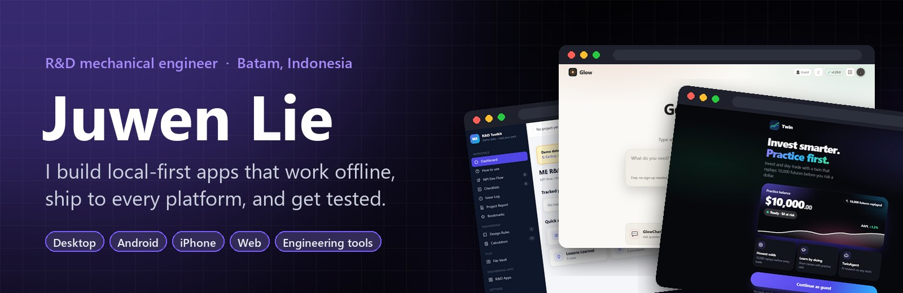</a>

  <b>R&D mechanical engineer with an aerospace background: product reliability, DVT, NPI and root-cause analysis.</b> 
  On the side I build offline-first tools and AI experiments, and I'm learning Fortran for CFD work.

  <a href="https://juwenlie.pages.dev/"><b>Portfolio</b></a> ·
  <a href="https://linkedin.com/in/juwenlie"><b>LinkedIn</b></a> ·
  <a href="mailto:juwen12006@gmail.com"><b>Email</b></a> ·
  <a href="#featured">Featured</a> ·
  <a href="#building">Building</a> ·
  <a href="#tools">Tools</a> ·
  <a href="#games">Games</a> ·
  <a href="#engineering">Engineering</a>

  
  
  
  
  

<table>
  <tr>
    <td width="33%" valign="top">
      <b>Local-first</b> 
      No account, no server required. Most of what I ship keeps working offline.
    </td>
    <td width="33%" valign="top">
      <b>Real apps on every platform</b> 
      Desktop installers, Android and iPhone builds, and a live web demo you can try right now.
    </td>
    <td width="33%" valign="top">
      <b>Built like hardware</b> 
      Test suites, versioned releases and an engineer's habit of verifying before shipping.
    </td>
  </tr>
</table>

## Featured

Ranked by maturity: test suites, shipped releases and commit history. Click any card to open the live demo.

<table>
  <tr>
    <td width="50%" valign="top">
      <a href="https://juw12.github.io/projects/twin/">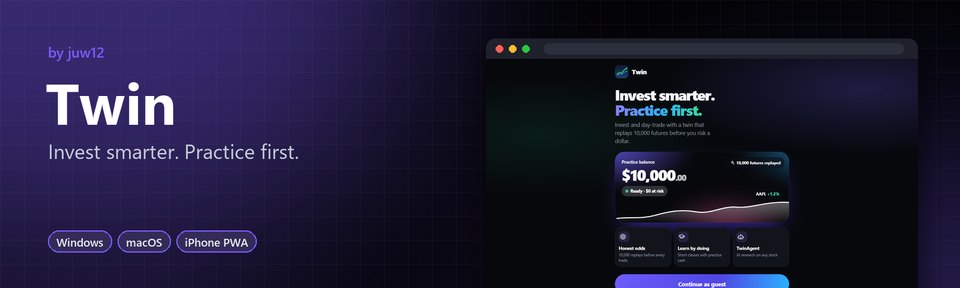</a> 
      <b><a href="https://juw12.github.io/projects/twin/">Twin</a></b>: Invest and day-trade with a twin that replays 10,000 futures before you risk real money. 
      <a href="https://juw12.github.io/projects/twin/">▶ Try it live</a> · <a href="https://github.com/juw12/projects/releases/tag/twin">⬇ Download</a> · <a href="https://github.com/juw12/projects/tree/main/apps/twin">Source</a>
    </td>
    <td width="50%" valign="top">
      <a href="https://juw12.github.io/projects/glow/">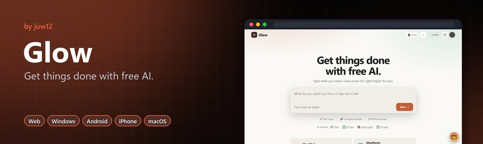</a> 
      <b><a href="https://juw12.github.io/projects/glow/">Glow</a></b>: Four AI apps on one free account, in 4 languages. No API keys, and it keeps working offline. 
      <a href="https://juw12.github.io/projects/glow/">▶ Try it live</a> · <a href="https://github.com/juw12/projects/releases/tag/glow-windows">⬇ Download</a> · <a href="https://github.com/juw12/projects/tree/main/apps/glow">Source</a>
    </td>
  </tr>
  <tr>
    <td width="50%" valign="top">
      <a href="https://juw12.github.io/projects/me-rd-toolkit/index.html">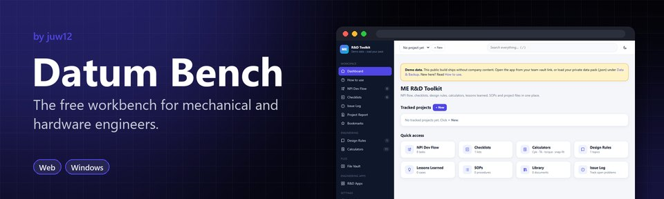</a> 
      <b><a href="https://juw12.github.io/projects/me-rd-toolkit/index.html">Datum Bench</a></b>: NPI task flow, review checklists, an issue log and 11 engineering calculators in one place. 
      <a href="https://juw12.github.io/projects/me-rd-toolkit/index.html">▶ Try it live</a> · <a href="https://github.com/juw12/projects/releases/tag/me-rd-toolkit">⬇ Download</a> · <a href="https://github.com/juw12/projects/tree/main/apps/me-rd-toolkit">Source</a>
    </td>
    <td width="50%" valign="top">
      <a href="https://github.com/juw12/projects/tree/main/apps/pushlab">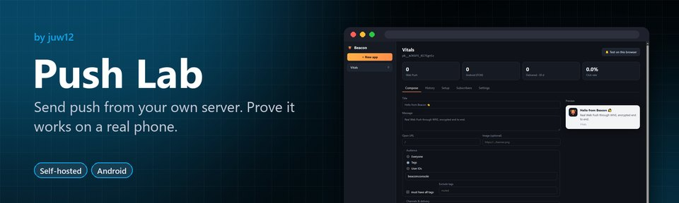</a> 
      <b><a href="https://github.com/juw12/projects/tree/main/apps/pushlab">Push Lab</a></b>: Beacon is a self-hosted push server, and Tether puts your Android phone in the browser with QA flows. 
      <a href="https://github.com/juw12/projects/tree/main/apps/pushlab">Source</a>
    </td>
  </tr>
  <tr>
    <td width="50%" valign="top">
      <a href="https://juw12.github.io/projects/mint/web.html">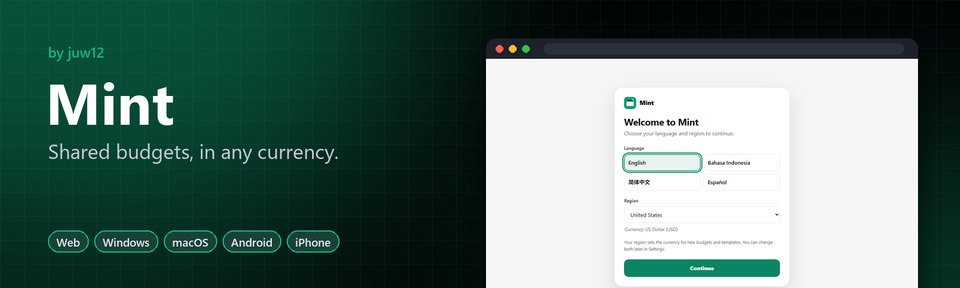</a> 
      <b><a href="https://juw12.github.io/projects/mint/web.html">Mint</a></b>: Synced on every device, with expenses you log by texting Mint on WhatsApp. 
      <a href="https://juw12.github.io/projects/mint/web.html">▶ Try it live</a> · <a href="https://github.com/juw12/projects/releases/tag/mint">⬇ Download</a> · <a href="https://github.com/juw12/projects/tree/main/apps/mint">Source</a>
    </td>
    <td width="50%" valign="top">
       
      <b><a href="https://juw12.github.io/projects/vitals/index.html">Vitals</a></b>: Cleans storage you can undo, forecasts battery wear and finds what drains your device. 
      <a href="https://juw12.github.io/projects/vitals/index.html">▶ Try it live</a> · <a href="https://github.com/juw12/projects/releases/tag/vitals">⬇ Download</a> · <a href="https://github.com/juw12/projects/tree/main/apps/vitals">Source</a>
    </td>
  </tr>
</table>

## Building

<b>23 projects in progress</b>, sorted by latest commit

<!-- BUILDING:START -->
<!--caption-->Sorted by latest commit and refreshed automatically every 2 hours.

- **[shiphub](https://github.com/juw12/shiphub)** : Pinterest for app ideas, with forum threads: save ideas to boards, discuss them, fork them, claim one with "I'm building this" and mark it shipped with repo and demo links. GitHub sign-in, plain Python with SQLite or Postgres. <!--live-->🟢 Updated Nov 3 · 8 commits this week · latest: [docs: Filee-style README hero (banner, live demo, badges, highlights, s…](https://github.com/juw12/shiphub/commit/5ebcf44c9db69bc12f19f2d082aaf571b74dfeb1)<!--/live-->
- **[Signals](https://github.com/juw12/signals)** : Free, $0-capital crypto signal bot: RSI + MACD + ATR + EMA confluence alerts on 4h candles, paper-trades every signal and ships with a backtester, a robustness sweep and a risk-capped Binance executor. One Python dependency. <!--live-->🟢 Updated Nov 3 · 2 commits this week · latest: [docs: Filee-style README hero (banner, live demo, badges, highlights, s…](https://github.com/juw12/signals/commit/344c9cd43d8fe7979316ac4d4f8b6e153a048122)<!--/live-->
- **[Nudge](https://github.com/juw12/nudge)** : Friends send you reels, you doomscroll past them. Nudge reads your own Instagram, WhatsApp, Telegram and iMessage exports and shows who you've been leaving on read, which shares you never answered, and a ready-to-send opener to reconnect. Weekly digest, iOS widget, Python CLI, 100% local. <!--live-->🟢 Updated Nov 3 · 10 commits this week · latest: [docs: Filee-style README hero (banner, live demo, badges, highlights, s…](https://github.com/juw12/nudge/commit/3f6ead4dc0116c4dedc10888f63b0de027132deb)<!--/live-->
- **[LaunchKit](https://github.com/juw12/launchkit)**  : Promote your app before it's finished. A waitlist where every friend you invite moves you up the line, confirmation and reward emails, an AI social media manager for build-in-public posts, tracked links that show which post brought each signup, and a launch-week plan with Product Hunt and Show HN checklists. Clean dashboard with a sidebar, dark mode and a phone-friendly layout; opens as a desktop app. Zero-dependency Python and SQLite. <!--live-->🟢 Updated Nov 3 · 3 commits this week · latest: [docs: Filee-style README hero (banner, live demo, badges, highlights, s…](https://github.com/juw12/launchkit/commit/e3556c49ebddfe43f67c87b47d4789907fbcd0b7)<!--/live-->
- **[Jeda](https://juw12.github.io/jeda/)**  : A quiet virtual space and living library for every faith in Indonesia (Islam, Protestant, Catholic, Hindu, Buddhist, Confucian and Chinese-Indonesian temple traditions), inspired by Korea's Sansa. Light incense or a candle in your own space, visit others' spaces respectfully, read teachings and rituals per stream and dialect, plan ceremonies, track holy days (Imlek, Hijri, Pawukon), and keep family memorial dates and traditions. Content is reviewed in the open by verified clergy, no account, works offline. Bahasa Indonesia. <!--live-->🟢 Updated Nov 3 · 13 commits this week · latest: [docs: Filee-style README hero (banner, live demo, badges, highlights, s…](https://github.com/juw12/jeda/commit/20f90767d9c06a308bd0da515a99b48c580143c1)<!--/live-->
- **[RepoRadar](https://juw12.github.io/reporadar/)**  : Find GitHub repos before they trend. Ranks repos by the stars they actually gained in 24 h, 7 d or 30 d, keeps a day-by-day GitHub Trending archive with streaks, and surfaces brand-new fast risers with a momentum score. Star-history charts, unseen-only discovery, a watchlist and side-by-side compare. Refreshed every 30 minutes by GitHub Actions; zero-dependency Python and a single HTML file. <!--live-->🟢 Updated Nov 3 · 2 commits this week · latest: [docs: Filee-style README hero (banner, live demo, badges, highlights, s…](https://github.com/juw12/reporadar/commit/3709635488faf0b61a9f49e698d31433fa277258)<!--/live-->
- **[Undanu](https://juw12.github.io/undanu/)**  : Digital wedding invitations for Indonesia with RSVP and a guest book. Couples design an envelope-style invitation with a live phone preview, send each guest a personal link on WhatsApp, see who opened it and who's coming, send reminders, collect wishes, song requests and gift or charity confirmations, and check guests in with a QR e-pass on the day. Templates for every religion in Indonesia (incl. Konghucu and Kepercayaan), video covers and motion-photo galleries, a LIVE badge for streamed ceremonies, Instagram Story sharing, Bahasa Indonesia / English, zero-dependency Python and SQLite. <!--live-->🟢 Updated Nov 3 · 5 commits this week · latest: [docs: Filee-style README hero (banner, live demo, badges, highlights, s…](https://github.com/juw12/undanu/commit/8c3fec563b487de59f30289cde036a2364f6e895)<!--/live-->
- **[Haru](https://juw12.github.io/projects/haru/app/)**  : A cozy photo diary, walking map and weather town in a Japanese/Korean indie style. Each day is a card with a tiny diorama lit by that day's weather, a photo, a note and the streets you walked, plus a screenshot tidy-up with on-device OCR. English, Japanese, Korean or both side by side. Runs in any browser; [Android, Windows and Mac downloads](https://github.com/juw12/projects/releases/tag/haru-latest). <!--live-->🟢 Updated Nov 3 · 4 commits this week · latest: [docs: Filee-style hero for every app README (banner, live demo, downloa…](https://github.com/juw12/projects/commit/4bcc1bdd5ae1b81ff2ee869aa72ca5499eff52f8)<!--/live-->
- **[ScopeGuard](https://juw12.github.io/projects/scopeguard/)** : Keeps a business AI assistant on its mission: allows on-topic requests, steers related ones back, redirects off-topic use without calling the LLM and blocks jailbreaks. Dashboard shows LLM cost avoided and what users really want; runs in the browser, with a self-hosted Python server for production. <!--live-->🟢 Updated Nov 3 · 2 commits this week · latest: [docs: Filee-style hero for every app README (banner, live demo, downloa…](https://github.com/juw12/projects/commit/4bcc1bdd5ae1b81ff2ee869aa72ca5499eff52f8)<!--/live-->
- **[CrewCup](https://github.com/juw12/projects/tree/main/apps/crewcup)**  : Office coffee for teams in Indonesia and Southeast Asia: order your usual in one tap or join a group coffee run, pay from the company allowance and pick up at partner cafés with your company badge. Includes a café order board, HR budgets and audit log, company rewards, points, tiers and coupons, and a network to meet other companies in your building. EN / ID, plain Python and SQLite. <!--live-->🟢 Updated Nov 3 · 2 commits this week · latest: [docs: Filee-style hero for every app README (banner, live demo, downloa…](https://github.com/juw12/projects/commit/4bcc1bdd5ae1b81ff2ee869aa72ca5499eff52f8)<!--/live-->
- **[Titian](https://github.com/juw12/projects/tree/main/respark)** : A broker-run B2B bridge for industrial manufacturers in Southeast Asia: each company gets a showcase with an interactive 3D catalog, RFQ basket and supplier portal, with every introduction screened by the operator. <!--live-->🟢 Updated Nov 3 · 3 commits this week · latest: [docs: Filee-style hero for every app README (banner, live demo, downloa…](https://github.com/juw12/projects/commit/4bcc1bdd5ae1b81ff2ee869aa72ca5499eff52f8)<!--/live-->
- **[KiniBuka](https://github.com/juw12/projects/tree/main/apps/kinibuka)** : Find small Indonesian UMKM stalls that are open right now: a live feed of openings, closings, promos and bazaars, a map with search, follow alerts, and order-ahead with a one-tap WhatsApp handoff. <!--live-->🟢 Updated Nov 3 · 2 commits this week · latest: [docs: Filee-style hero for every app README (banner, live demo, downloa…](https://github.com/juw12/projects/commit/4bcc1bdd5ae1b81ff2ee869aa72ca5499eff52f8)<!--/live-->
- **[Sortie](https://juw12.github.io/projects/sortie/)** : A file organizer that's fun to use: sorted files fly into their folders and a vacuum cleaner sucks up deletes into a recoverable bag. Ask the AI assistant in plain words and it shows a plan you Run or Cancel. Everything is undoable. <!--live-->🟢 Updated Nov 3 · 2 commits this week · latest: [docs: Filee-style hero for every app README (banner, live demo, downloa…](https://github.com/juw12/projects/commit/4bcc1bdd5ae1b81ff2ee869aa72ca5499eff52f8)<!--/live-->
- **[E-coder](https://github.com/juw12/projects/tree/main/agents-lab/E-coder)** : A stdlib-only coding agent that reads a repo with gitignore-aware tools, plans, edits files and runs commands behind a deny-list and fail-closed confirmation. Default model is local Ollama, no API keys. 67 hermetic tests, zero third-party deps. <!--live-->🟢 Updated Nov 3 · 6 commits this week · latest: [docs: Filee-style hero for every app README (banner, live demo, downloa…](https://github.com/juw12/projects/commit/4bcc1bdd5ae1b81ff2ee869aa72ca5499eff52f8)<!--/live-->
- **[Pips](https://juw12.github.io/projects/pips/web.html)** : Desktop pet and Pomodoro widget for Windows: 51 animals that walk, swim and fly, friends and chat, turn-based skill battles, minigames, live weather and 4 languages. Includes Focus Trail and Phone Trail. <!--live-->🟢 Updated Nov 3 · 51 commits this week · latest: [docs: Filee-style hero for every app README (banner, live demo, downloa…](https://github.com/juw12/projects/commit/4bcc1bdd5ae1b81ff2ee869aa72ca5499eff52f8)<!--/live-->
- **[Teman Sehat](https://juw12.github.io/projects/teman-sehat/)** : GERD and acne lifestyle companion in English and Bahasa Indonesia: daily reminders, an after-meal timer, a symptom and trigger log, diet and fitness without fasting, and acne care with a skin routine. <!--live-->🟢 Updated Nov 3 · 2 commits this week · latest: [docs: Filee-style hero for every app README (banner, live demo, downloa…](https://github.com/juw12/projects/commit/4bcc1bdd5ae1b81ff2ee869aa72ca5499eff52f8)<!--/live-->
- **[Hazel](https://juw12.github.io/projects/hazel/)** : One creator studio, three apps: Hazel Shorts for faceless explainer shorts, Hazel Sped for sped-up and mashup edits of your songs, and Hazel Long to create, cut and publish long-form video. <!--live-->🟢 Updated Nov 3 · 3 commits this week · latest: [docs: Filee-style hero for every app README (banner, live demo, downloa…](https://github.com/juw12/projects/commit/4bcc1bdd5ae1b81ff2ee869aa72ca5499eff52f8)<!--/live-->
- **[Peers](https://juw12.github.io/projects/peers/)** : Verified reviews across category modes (food, travel, market, AI tools, health, finance). Every category shares one interface, with a built-in Use it / Wait / Skip scorecard. <!--live-->🟢 Updated Nov 3 · 3 commits this week · latest: [docs: Filee-style hero for every app README (banner, live demo, downloa…](https://github.com/juw12/projects/commit/4bcc1bdd5ae1b81ff2ee869aa72ca5499eff52f8)<!--/live-->
- **[Sweep](https://github.com/juw12/projects/tree/main/apps/sweep)** : The `/sweep` pipeline: validate an idea, then sync the repo to GitHub and mirror a note to Obsidian. PowerShell helper plus an OpenCode slash command. <!--live-->🟢 Updated Nov 3 · 3 commits this week · latest: [docs: Filee-style hero for every app README (banner, live demo, downloa…](https://github.com/juw12/projects/commit/4bcc1bdd5ae1b81ff2ee869aa72ca5499eff52f8)<!--/live-->
- **[Orbis](https://juw12.github.io/projects/orbis/)** : Communication, identity and protection in one app, plus Orbis Chat: real-time messaging with accounts, teams, email invites and push notifications on web, iPhone and Android. <!--live-->🟢 Updated Nov 3 · 4 commits this week · latest: [docs: Filee-style hero for every app README (banner, live demo, downloa…](https://github.com/juw12/projects/commit/4bcc1bdd5ae1b81ff2ee869aa72ca5499eff52f8)<!--/live-->
- **[Sync](https://juw12.github.io/projects/sync/)** : Listen to music together in real time from anywhere, with Spotify, Apple Music, YouTube and shared files in one room, plus voice chat that lowers the music. <!--live-->🟢 Updated Nov 3 · 1 commit this week · latest: [docs: Filee-style hero for every app README (banner, live demo, downloa…](https://github.com/juw12/projects/commit/4bcc1bdd5ae1b81ff2ee869aa72ca5499eff52f8)<!--/live-->
- **[Guang Yao Together 光耀同行](https://juw12.github.io/projects/guangyao/)** : An unofficial Traditional Chinese learning app with admin-published lessons, an AI study companion, spaced review and streaks. A PWA, an Android app and a free iPhone home-screen app. <!--live-->🟢 Updated Nov 3 · 1 commit this week · latest: [docs: Filee-style hero for every app README (banner, live demo, downloa…](https://github.com/juw12/projects/commit/4bcc1bdd5ae1b81ff2ee869aa72ca5499eff52f8)<!--/live-->
- **[House of Articles](https://juw12.github.io/projects/house-of-articles/)** : Athlete-moment sneaker news plus a live market feed, linking on-court moments to resale price moves. <!--live-->🟢 Updated Nov 3 · 1 commit this week · latest: [docs: Filee-style hero for every app README (banner, live demo, downloa…](https://github.com/juw12/projects/commit/4bcc1bdd5ae1b81ff2ee869aa72ca5499eff52f8)<!--/live-->
<!-- BUILDING:END -->

## Tools

Small, local, private tools for underrated problems. Python standard library only, no accounts, every tool has a self-test. <a href="https://github.com/juw12/tools">Source &amp; docs</a>

<b>20 tools</b> in <a href="https://github.com/juw12/tools">juw12/tools</a>, plus a factory to build more (<code>python3 toolbox.py new &lt;name&gt;</code>)

| Area | Tools |
|---|---|
| 💸 Money | [Subscription Leak Finder](https://github.com/juw12/tools/blob/main/tools/subscription_leaks.py) · [Bank Fee Detector](https://github.com/juw12/tools/blob/main/tools/fee_detector.py) · [Contract Red-Flag Scanner](https://github.com/juw12/tools/blob/main/tools/contract_redflags.py) · [Shrinkflation Detector](https://github.com/juw12/tools/blob/main/tools/shrinkflation.py) · [Warranty Tracker](https://github.com/juw12/tools/blob/main/tools/warranty_tracker.py) |
| 🛡️ Safety | [Scam Message Checker](https://github.com/juw12/tools/blob/main/tools/scam_check.py) · [Fake Shop Checker](https://github.com/juw12/tools/blob/main/tools/fake_shop_check.py) · [Rental Scam Checker](https://github.com/juw12/tools/blob/main/tools/rental_scam_check.py) · [Voice-Clone Safe-Word Kit](https://github.com/juw12/tools/blob/main/tools/voice_clone_safeword.py) |
| 🔒 Privacy | [GDPR / CCPA Deletion Request Generator](https://github.com/juw12/tools/blob/main/tools/privacy_requests.py) |
| 🌡️ Climate | [Heat Risk Planner](https://github.com/juw12/tools/blob/main/tools/heat_risk.py) · [Hidden Water Leak Detector](https://github.com/juw12/tools/blob/main/tools/water_leak.py) · [Energy Upgrade Payback](https://github.com/juw12/tools/blob/main/tools/energy_payback.py) |
| 🤝 Care | [Caregiver Medication Planner](https://github.com/juw12/tools/blob/main/tools/med_refills.py) · [Unclaimed Benefits Screener](https://github.com/juw12/tools/blob/main/tools/benefit_finder.py) |
| 🗄️ Future-proofing | [Digital Legacy Planner](https://github.com/juw12/tools/blob/main/tools/legacy_planner.py) · [Account Recovery Audit](https://github.com/juw12/tools/blob/main/tools/account_recovery_audit.py) · [3-2-1 Backup Auditor](https://github.com/juw12/tools/blob/main/tools/backup_check.py) · [Bit-Rot Guard](https://github.com/juw12/tools/blob/main/tools/bitrot_guard.py) · [File Format Rescue](https://github.com/juw12/tools/blob/main/tools/file_rescue.py) |

## Games

<table>
  <tr>
    <td width="50%" valign="top">
      <a href="https://juw12.github.io/portfolio/game/townsquare/">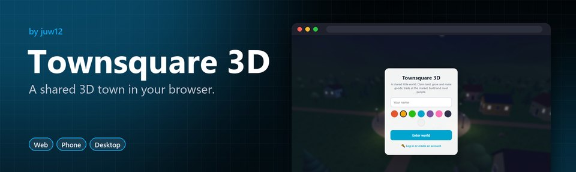</a> 
      <b><a href="https://juw12.github.io/portfolio/game/townsquare/">Townsquare 3D</a></b>: A shared 3D town for phone and desktop browsers: claim land, run crops and workshops, trade at a market that follows supply and demand. 
      <a href="https://juw12.github.io/portfolio/game/townsquare/">▶ Play now</a> · <a href="https://github.com/juw12/portfolio/tree/main/game/townsquare">Source</a>
    </td>
    <td width="50%" valign="top">
      <a href="https://juw12.github.io/portfolio/game/">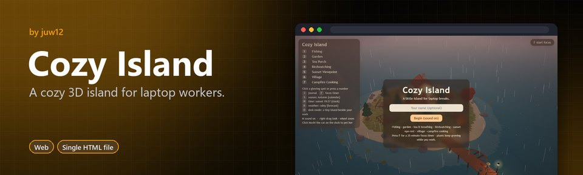</a> 
      <b><a href="https://juw12.github.io/portfolio/game/">Cozy Island</a></b>: A cozy 3D island for laptop workers: fish, garden, take tea-breathing breaks and rest your eyes, with Mochi the cat. 
      <a href="https://juw12.github.io/portfolio/game/">▶ Play now</a> · <a href="https://github.com/juw12/portfolio/tree/main/game">Source</a>
    </td>
  </tr>
  <tr>
    <td width="50%" valign="top">
      <a href="https://juw12.github.io/vale/">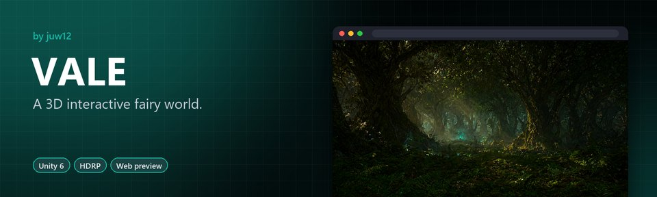</a> 
      <b><a href="https://juw12.github.io/vale/">VALE</a></b>: A first-person explorer: collect five Lumenshards to restore a fading fairy realm. 
      <a href="https://juw12.github.io/vale/">▶ Try it live</a> · <a href="https://github.com/juw12/vale">Source</a>
    </td>
    <td width="50%" valign="top">
      <a href="https://github.com/juw12/hearthwood">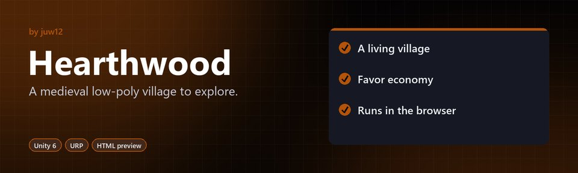</a> 
      <b><a href="https://github.com/juw12/hearthwood">Hearthwood</a></b>: A third-person action-adventure prototype with dialogue, quests, inventory and NPC AI. 
      <a href="https://github.com/juw12/hearthwood">Source</a>
    </td>
  </tr>
</table>

## Engineering

<table>
  <tr>
    <td width="50%" valign="top">
       
      <b><a href="https://juw12.github.io/projects/airiz-motor/">Airiz Motor</a></b>: USB jog, remote control and camera by code, live device checks and a camera-based wobble test. 
      <a href="https://juw12.github.io/projects/airiz-motor/">▶ Try it live</a> · <a href="https://github.com/juw12/projects/releases/tag/airiz-desktop-v1.11.25">⬇ Download</a> · <a href="https://github.com/juw12/projects/tree/main/apps/airiz-motor">Source</a>
    </td>
    <td width="50%" valign="top">
      <a href="https://github.com/juw12/projects/tree/main/apps/me-rd-toolkit/photo2cad">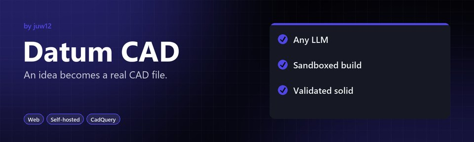</a> 
      <b><a href="https://github.com/juw12/projects/tree/main/apps/me-rd-toolkit/photo2cad">Datum CAD</a></b>: A PRD plus six reference photos becomes a validated STEP solid, with an STL preview. 
      <a href="https://github.com/juw12/projects/tree/main/apps/me-rd-toolkit/photo2cad">Source</a>
    </td>
  </tr>
  <tr>
    <td width="50%" valign="top">
      <a href="https://github.com/juw12/Explicit-Maccormack-Method">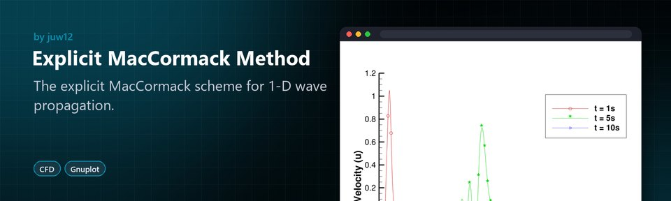</a> 
      <b><a href="https://github.com/juw12/Explicit-Maccormack-Method">Explicit MacCormack Method</a></b>: A computational fluid dynamics study of a predictor-corrector scheme, with plotted results. 
      <a href="https://github.com/juw12/Explicit-Maccormack-Method">Source</a>
    </td>
    <td width="50%" valign="top">
       
      <b><a href="https://github.com/juw12/Upwind-Differencing-Scheme">Upwind Differencing Scheme</a></b>: A computational fluid dynamics study of upwind differencing, with plotted results. 
      <a href="https://github.com/juw12/Upwind-Differencing-Scheme">Source</a>
    </td>
  </tr>
</table>

## Archive

Prompt packs and product experiments kept on record

- **[Atomize](https://github.com/juw12/atomize)** : AI content repurposing SaaS. Paste one blog post, get 5 LinkedIn posts, 8 tweets, 3 newsletters and a YouTube Short script. Next.js 14 + Claude, Lemon Squeezy for payments.
- **[150 ChatGPT Prompts for Etsy Sellers](https://github.com/juw12/projects/tree/add/etsy-prompts-product/apps/building/etsy-prompts-product)**: 150 copy-paste prompts across 9 sections, packaged as a 6-phase workflow that writes an Etsy listing in 5 minutes. PDF + Notion template.
- **[Respark](https://github.com/juw12/projects/tree/main/respark)**: Customer reactivation SaaS for local service businesses. Zero-dependency Python + SQLite, 43 tests passing.
- **[Handoff](https://github.com/juw12/loop-zero)** : AI automation agency plus SaaS product for SMBs. Five Next.js apps, cold-outreach copy and a 14-day validation playbook.

---

  The full monorepo: <a href="https://github.com/juw12/projects"><b>juw12/projects</b></a> ·
  <a href="https://github.com/juw12?tab=repositories">All repositories</a>

  Independent personal projects. No employer endorsement implied. Demos and prototypes vary in maturity; check each README before use. 
  If something here is useful, a ⭐ on the repo helps, and <a href="https://github.com/juw12">following @juw12</a> keeps you posted on what ships next.

